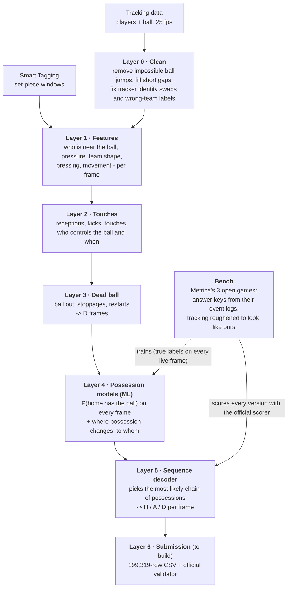

# Mall Pipeline: who has the ball, frame by frame

Our entry for **More than a Hack 2027** (Metrica Sports × FC Barcelona). For every one of the
199,319 video frames of Barcelona vs Athletic Club, the pipeline outputs **H** (home has the ball),
**A** (away has the ball) or **D** (dead ball). It is ranked on spellF1 (whole possessions), with
macroF1 (single frames) as the tie-break.

The organisers' original README is in [`COMPETITION_README.md`](COMPETITION_README.md).

## The pipeline



| Layer | Folder | What it does |
|---|---|---|
| 0 | `possession/layer0_clean` | Cleans the tracking: drops ball detections that move impossibly fast, fills gaps up to 1 s, splits tracks where the tracker swapped two players, repairs players given to the wrong team |
| 1 | `possession/layer1_features` | Physics features per frame: distances to the ball, players under pressure, team shape and position, pressing, movement |
| 2 | `possession/layer2_touches` | Finds touches from the ball's speed and direction changes (receptions, kicks, deflections) and who made them, plus spells where a player controls the ball |
| 3 | `possession/layer3_dead_ball` | Detects stoppages (ball out, fouls, restarts) from ball position, ball gaps, players slowing down and set-piece shapes |
| 4 | `possession/layer4_possession_model` | Two gradient-boosted models trained on the bench games: the chance that home has the ball (looking 8 s back and ahead), and the chance that possession passes to home or away at each moment |
| 5 | `possession/layer5_sequence_decoder` | Combines it all: possession can only change at a credible moment (a reception, a kick, a learned change point), and the decoder picks the best overall sequence |
| bench | `possession/bench` | Metrica's 3 open sample games, turned into a scored test set: frame-level answer keys from their event logs (following Metrica's own event definitions), tracking roughened to match ours |

## Results

| | Baseline (nearest player) | Pipeline v0 | Pipeline v1 (current) |
|---|---|---|---|
| Bench spellF1 (3 games, models never trained on the game scored) | 0.361 | 0.508 | **0.681** |
| Bench macroF1 | 0.816 | 0.870 | **0.901** |
| Public 5 minutes of the challenge match, spellF1 / macroF1 | 0.326 / 0.621 | 0.545 / 0.830 | **0.562 / 0.848** |

- **v0:** the layer-4 model learned only from calm, certain moments of the challenge match, and
  the decoder settings were set by hand.
- **v1:** layer 4 trains on true labels from the bench games, and the decoder settings were chosen
  on the bench.
- **The public 5 minutes are only a sanity check.** The rules forbid tuning on them, and with
  only 17 possessions, one possession moves spellF1 by about 6 points.

## Running it

```
pip install -r requirements.txt
git clone https://github.com/metrica-sports/sample-data   # bench games; set BENCH_SRC to its path
python -m possession.bench.build                           # bench answer keys + degraded tracking
python -m possession.bench.score                           # layers 1-5 on the bench, official scorer
# then layers 0-5 on the challenge match (data in data/, see DATA.md):
python -m possession.layer0_clean.run
python -m possession.layer1_features.run
python -m possession.layer2_touches.run
python -m possession.layer3_dead_ball.run
python -m possession.layer4_possession_model.run
python -m possession.layer5_sequence_decoder.run
python -m possession.compare_models
```

Every setting is in `possession/config.py`, and each layer folder has a README explaining its
choices and checks. `cache/` (frame-level data derived from the match) is never committed, as
the rules forbid redistributing it. `bench_keys/` holds the bench answer keys.

## What's next

- **More training games:** DFL / Sportec open data (7 Bundesliga matches).
- **Layer 6:** write the submission CSV and check it with the official validator.
- **Short possessions:** under 3 s, still the main source of error.
